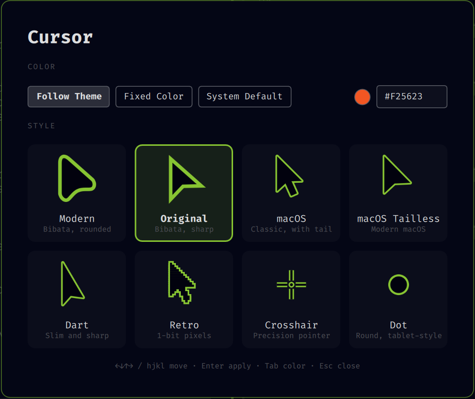

# Cursor Accent

Recolors the system pointer to match the active Omarchy theme's accent
color, automatically, every time you switch themes. No matugen, no new
runtime dependencies: it uses Hyprland's own `hyprcursor-util` (already
installed, since `hyprcursor` is a hard dependency of Hyprland itself) to
compile a [Bibata](https://github.com/ful1e5/Bibata_Cursor) cursor recolored
on the fly from each theme's `colors.toml`.

Also supports locking to one fixed color regardless of theme, turning it off
entirely to use the system default cursor, and eight pointer styles: Bibata's
"Modern" (rounded) and "Original" (sharp), plus macOS, macOS Tailless, Dart,
Retro, Crosshair, and Dot. A settings window lets you pick all of it with
live previews.



## Install

```sh
omarchy plugin add https://github.com/SmoothPixels/cursor-accent.git --enable
```

Installing the plugin alone does nothing visible yet: it only ships the
mechanism (`recolor.py`) and, while the plugin is enabled, a one-time apply
each time the shell loads it. Following the theme is opt-in, run once
yourself:

```sh
# Follow the active theme automatically from now on, on every `omarchy theme set`
~/.config/omarchy/plugins/io.github.smoothpixels.cursor-accent/tools/install-cursor-hook.sh
```

This generates and installs two hooks through `omarchy hook install`, both
documented Omarchy extension points, adds the Style > Cursor menu (see
[Menu](#menu)), and applies the current theme's colors immediately:

- `theme-set` runs on every `omarchy theme set` and recolors the cursor to
  the new theme.
- `post-boot` runs once per login and re-applies it. `hyprctl setcursor` only
  lasts for the running compositor, and Omarchy sets no `HYPRCURSOR_THEME`,
  so without this hook Hyprland starts with whichever theme directory
  hyprcursor finds first under `~/.local/share/icons`, which is not
  necessarily this one.

The hooks are generated rather than shipped as static files because
`omarchy-hook-install` copies them into `~/.config/omarchy/hooks/<type>.d/`,
not a symlink, so they need this plugin's real install path baked in. If you
set up an earlier version, re-run the script once to add the `post-boot` hook
and the menu. Nothing else in this plugin touches your configuration on its
own.

## Settings

Open the settings window from the Omarchy menu (search
`cursor-style-settings`, or Style > Cursor > Cursor Style Settings…), or run:

```sh
~/.config/omarchy/plugins/io.github.smoothpixels.cursor-accent/cursor-accent settings
```

Pick Follow Theme, Fixed Color (type a `#rrggbb` and press Enter), or System
Default, then a style. The previews are drawn in the colors you'll get.
Arrow keys or hjkl move, Enter applies, Tab jumps to the color field, Esc
closes.

Everything in the window is also available from the bundled `cursor-accent`
command:

```sh
~/.config/omarchy/plugins/io.github.smoothpixels.cursor-accent/cursor-accent follow
~/.config/omarchy/plugins/io.github.smoothpixels.cursor-accent/cursor-accent fixed '#39ff14'
~/.config/omarchy/plugins/io.github.smoothpixels.cursor-accent/cursor-accent default
~/.config/omarchy/plugins/io.github.smoothpixels.cursor-accent/cursor-accent shape retro
~/.config/omarchy/plugins/io.github.smoothpixels.cursor-accent/cursor-accent status
```

| Command | Effect |
| --- | --- |
| `follow` | Recolor to the active theme's accent, and keep following it on every theme switch (default). |
| `fixed '#rrggbb'` | Lock to one color, ignoring theme switches. |
| `default` | Turn this off. Reverts to the system's own default cursor (the theme literally named `default`, inherited from Adwaita), and stays off through theme switches until you pick `follow` or `fixed` again. |
| `shape <shape>` | Pick a pointer style (table below). |
| `shapes` | List the valid shapes. |
| `settings` | Open the settings window. |
| `status` | Print the current mode, shape, and fixed color as JSON. |

| Shape | Look |
| --- | --- |
| `modern` | Bibata's rounded pointer (default). |
| `original` | Bibata's classic sharp-edged pointer. |
| `macos` | The classic Mac arrow, with its tail. |
| `macos-tailless` | The modern, tailless macOS arrow. |
| `dart` | A slim, sharp, elongated arrow. |
| `retro` | A 1-bit pixel-art arrow. |
| `crosshair` | A precision crosshair as the everyday pointer. |
| `dot` | A round, tablet-style dot. |

Every style recolors the same way, and comes with a full set (text, resize,
hands, busy, and so on). Crosshair and Dot only change the plain pointers and
use the macOS Tailless set for the rest.

Your choice is stored in `~/.local/state/cursor-accent/config.json`, outside
the plugin's own directory, so `omarchy plugin update` never resets it.

## Menu

`install-cursor-hook.sh` adds a "Style > Cursor" submenu: Cursor Style
Settings…, a checkable row per mode and style, and "Fixed Color..." to prompt
for a hex value. To add only the menu, without the hooks:

```sh
~/.config/omarchy/plugins/io.github.smoothpixels.cursor-accent/tools/install-menu-entries.sh
```


Omarchy has no way for a plugin to add menu rows itself, so this splices
`extensions/omarchy-menu.snippet.jsonc` into your own
`~/.config/omarchy/extensions/omarchy-menu.jsonc` (creating it if missing),
between `>>> cursor-accent` / `<<< cursor-accent` comments. The shell watches
that file, so it applies within a second or two. Nothing writes there unless
you run one of these scripts; after that, the plugin re-syncs the block when
an update changes it, so new rows show up on their own. To remove it, delete
that block.

## Remove

```sh
rm -f ~/.config/omarchy/hooks/{theme-set,post-boot}.d/cursor-accent.sh
# and delete the >>> cursor-accent >>> block from ~/.config/omarchy/extensions/omarchy-menu.jsonc
rm -rf ~/.local/share/icons/Omarchy-Accent ~/.local/state/cursor-accent
hyprctl setcursor default 24               # or your preferred size
omarchy plugin remove io.github.smoothpixels.cursor-accent
```

## Development

The extra styles are drawn by `tools/gen-cursor-styles.py`, which writes
`svg/groups/<style>/`, `config/build.<style>.toml` (hotspots), and the
previews in `assets/previews/`. Re-run it after changing a shape.

`src/`, `svg/`, and `config/` are vendored from
[rtgiskard/bibata_cursor](https://github.com/rtgiskard/bibata_cursor) (see
NOTICE.md), pinned to a known-good commit rather than fetched at install
time, so there's no network access at runtime. `recolor.py` patches a
scratch copy of `config/render.json` with the current colors, symlinks the
vendored `src/`/`svg/` into a scratch build directory (to avoid copying
~1.5MB on every theme switch), and runs `cursor_utils.py --hypr` there.

Validate before publishing:

```sh
omarchy plugin validate ~/.config/omarchy/plugins/io.github.smoothpixels.cursor-accent
qmllint -I "$OMARCHY_PATH/shell" ~/.config/omarchy/plugins/io.github.smoothpixels.cursor-accent/{Service,CursorSettings}.qml
```
